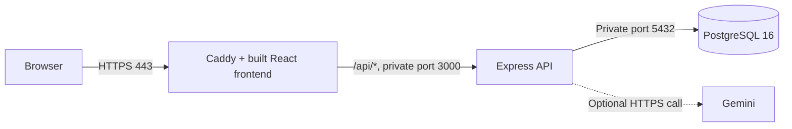

# ShopSmart on a separate EC2 instance

This deployment serves the built React frontend and Express API through Caddy on
one ShopSmart EC2 instance. PostgreSQL runs in its own private container. It does
not use SAM10's instance, proxy, database, secret parameters, or backups.



These are deployment preparation files, not evidence of a completed AWS release.
Customer sign-in and order ownership are still missing from the app. Use fictional
data and restrict the staging audience while those requirements are unfinished;
do not describe this release as satisfying the complete learning guide.

Existing dependency findings also need review before public release. On November
20, 2026, `npm audit --workspace backend --omit=dev` reported 10 findings: one
critical, six high, and three moderate. Dependency versions have not been changed
in this deployment branch. Build-tool findings are separate from this check.

## Server settings

Confirm instructor approval, remaining credits, and credit expiry first. Keep both
projects available through November 30, 2026, and confirm grading is complete before
removing either deployment.

| Setting | ShopSmart value |
| --- | --- |
| Region | Singapore (`ap-southeast-1`) |
| Instance | `t3.small`, x86, **Standard** CPU-credit mode |
| Operating system | Ubuntu Server 24.04 LTS |
| Root storage | 20 GiB encrypted gp3; default IOPS and throughput |
| Address | One Elastic IP associated with this instance |
| HTTPS hostname | `shopsmart.<ELASTIC_IP>.sslip.io`, or a domain you control |
| Administration | Session Manager with its required instance role, or SSH restricted to your own IP |
| Public application ports | TCP 80 for certificate validation/redirects; TCP 443 for HTTPS; UDP 443 optional for HTTP/3 |
| Private ports | Do not publish 3000 or 5432 in the security group or Compose |

For restricted staging, allow HTTPS from the team/instructor IPs while leaving
HTTP reachable for certificate validation. Do not attach SAM10's runtime IAM role.
The default catalog assistant needs no AWS application permissions or AI key.
No RDS, load balancer, NAT gateway, email service, or new monitoring stack is needed
for this package. Public IPv4 and disk storage still consume credits.

The free `sslip.io` hostname resolves the embedded IP. Caddy obtains and renews a
trusted certificate for that hostname. A bare IP is not interchangeable with this
setup: it requires a separate publicly trusted IP-certificate configuration.
Check that the hostname resolves to the new ShopSmart IP before publishing.

## Install the runtime

Run on the **new ShopSmart EC2 server**, not SAM10, Windows, or CloudShell.
Install Docker Engine and the Compose plugin using the
[official Ubuntu installation instructions](https://docs.docker.com/engine/install/ubuntu/).
Then install Git if necessary and enable Docker at boot:

```bash
sudo apt-get update
sudo apt-get install -y git openssl
sudo systemctl enable --now docker
sudo docker version
sudo docker compose version
```

Push the reviewed branch yourself before downloading it. In a new directory:

```bash
git clone --branch deployment-aws https://github.com/kbfrrr/shopsmart.git shopsmart
cd shopsmart
git rev-parse HEAD
```

Record the commit for the release evidence. The clone must contain both workspaces,
the root lockfile, and these deployment files.

## Configure the server privately

From the repository root:

```bash
umask 077
cp deployment/aws/.env.example deployment/aws/.env
chmod 600 deployment/aws/.env
openssl rand -hex 24
```

Keep the generated password private. Edit `deployment/aws/.env` on the server:

- Set `POSTGRES_PASSWORD` to the generated 48 hexadecimal characters. Hex avoids
  URL-escaping issues in the internal connection string.
- Set `SITE_ADDRESS` to the hostname only, such as
  `shopsmart.203.0.113.10.sslip.io`, replacing the example IP with your actual IP.
- Set `FRONTEND_URL` to the corresponding origin, including `https://` and no
  trailing slash.
- Set `SHOPSMART_IMAGE_TAG` to the short release commit from `git rev-parse --short HEAD`.
- Leave `GEMINI_API_KEY` blank for catalog mode. An approved key, if used, stays here.

Keep this file for subsequent deployments. Changing `POSTGRES_PASSWORD` does not
change the password inside an existing PostgreSQL volume; rotate database credentials
deliberately rather than regenerating them during an update.

No real server `.env` file is copied into an image. The frontend is built with
`VITE_API_URL=/api`, so browser requests use the same HTTPS origin. Caddy passes
only API requests to Express and serves `index.html` for frontend route refreshes.
Express trusts one proxy only when `TRUST_PROXY=1`, as set by this private stack.

Validate without printing the expanded configuration or secrets:

```bash
sudo docker compose --env-file deployment/aws/.env -f deployment/aws/compose.yaml config --quiet
```

## Build and start

Build the images sequentially to limit peak memory use on the 2 GiB server:

```bash
sudo docker compose --env-file deployment/aws/.env -f deployment/aws/compose.yaml build api
sudo docker compose --env-file deployment/aws/.env -f deployment/aws/compose.yaml build web
sudo docker compose --env-file deployment/aws/.env -f deployment/aws/compose.yaml up -d
sudo docker compose --env-file deployment/aws/.env -f deployment/aws/compose.yaml ps -a
```

Startup waits for PostgreSQL, applies committed migrations with
`prisma migrate deploy`, and runs the non-destructive catalog initializer. Only
then does the API start. Caddy waits for the API's database readiness check.
The `migrate` container should finish with exit code 0; it is not a long-running
service. PostgreSQL, the API, and Caddy restart automatically after a host reboot.
Only the web service publishes host ports. CPU/memory limits and rotating logs
bound the normal container resource usage; build processes have separate limits.

The initializer inserts six sample products only if products, orders, and order
items are all empty. It never deletes or replaces data and skips existing data on
redeployment. Concurrent initializers use serializable transactions; an unsuccessful
run must be investigated or retried before starting the API. Never use
`npm run db:seed`, `migrate dev`, or `migrate reset` to repair the deployed database.

## Verify before sharing access

Use the actual HTTPS hostname in a fresh browser:

1. Open `/`, `/products/2`, `/cart`, and `/assistant` directly and refresh each route.
2. Check `/api/health` for process liveness and `/api/ready` for database connectivity.
   Readiness returns 503 with a generic response if the database is unavailable.
3. Confirm `/api/products` contains the catalog. An unknown `/api/...` route must
   return an API 404, not frontend HTML.
4. Test search, stock limits, the 20-unit cart limit, totals, and a fictional simulated
   checkout. Confirm an invalid order is rejected and no real payment is collected.
5. Test assistant matches, no matches, and the visible catalog-mode label. A live
   provider call is not verified by catalog-mode success.
6. Restart the API, then reboot the ShopSmart host in a separate check. Verify
   recovery, HTTPS, the saved order, and the reduced stock. Do not reboot SAM10.
7. Record the URL, commit, image identifiers, test time, statuses, credit balance,
   and redacted evidence. Record the remaining authentication requirement explicitly.

For service failures, inspect only the required logs:

```bash
sudo docker compose --env-file deployment/aws/.env -f deployment/aws/compose.yaml logs --tail 50 migrate api web
```

Review and redact logs before sharing. Do not dump container environments, real
`.env` files, or expanded Compose settings into screenshots or the repository.
If the API is unready, inspect migrations and connectivity; do not reset data.

## Preserve data during updates

Create a private database backup before applying a new release:

```bash
umask 077
mkdir -p deployment/aws/backups
sudo docker compose --env-file deployment/aws/.env -f deployment/aws/compose.yaml exec -T postgres sh -c 'pg_dump -U "$POSTGRES_USER" -d "$POSTGRES_DB" --format=custom' > "deployment/aws/backups/shopsmart-$(date -u +%Y%m%dT%H%M%SZ).dump"
```

Check that the command succeeded and the backup is nonempty. This directory is
excluded from Git and Docker builds. Keep an additional private copy off the
instance; the local file does not protect against losing the host or volume.
Test recovery in a separate database before claiming the backup is recoverable.

For each update, record the old commit/image tag, use the reviewed new commit and
a new `SHOPSMART_IMAGE_TAG`, build both images, and stop only the ShopSmart web and
API services while applying the migration:

```bash
sudo docker compose --env-file deployment/aws/.env -f deployment/aws/compose.yaml stop web api
sudo docker compose --env-file deployment/aws/.env -f deployment/aws/compose.yaml run --rm migrate
```

Start the release with `up -d` only after migration succeeds, and repeat the hosted
checks. Migrations are not automatically reversible. Keep the previous images and
backup; roll back code only when it remains compatible with the applied schema.

Named volumes preserve PostgreSQL data and Caddy certificate state across ordinary
container recreation. Do not use `down -v` or prune volumes. Export the private backup
and evidence before any final EC2/volume removal. Release only ShopSmart's Elastic IP
when grading is complete; SAM10 has its own independent removal decision.

## Local validation

Local validation on November 20, 2026: both lint checks, 39 tests, and the Vite
build passed; both Linux images built. An isolated Compose smoke test verified
database initialization, liveness/readiness, frontend route refreshes, API 404s,
checkout, invalid quantities, and the catalog assistant. A second migration/init
run and database/API restarts preserved the order, catalog, and stock change.
Disposable test containers and volumes were removed. The local test used HTTP
on a loopback port; AWS provisioning and public HTTPS issuance remain untested.

## References

- [Compose startup dependencies](https://docs.docker.com/compose/how-tos/startup-order/)
- [Caddy automatic HTTPS](https://caddyserver.com/docs/automatic-https)
- [Prisma 6 release migrations](https://www.prisma.io/docs/orm/v6/prisma-migrate/workflows/development-and-production)
- [Docker resource constraints](https://docs.docker.com/engine/containers/resource_constraints/)
