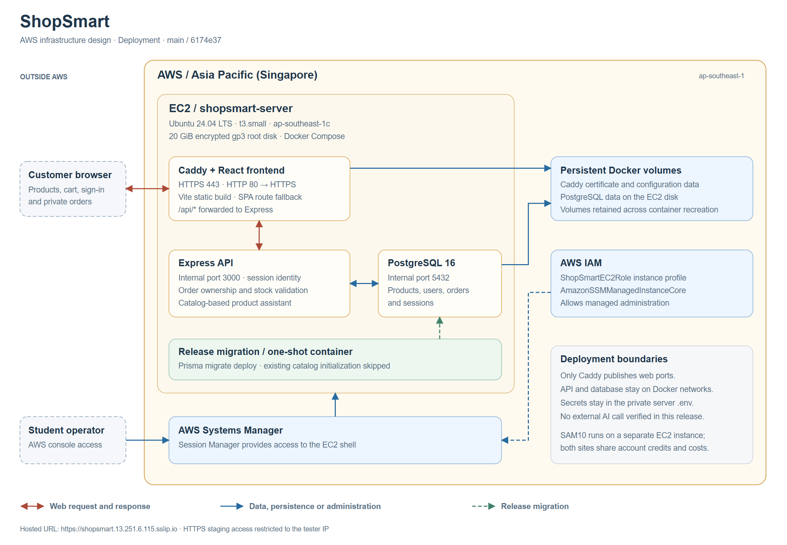
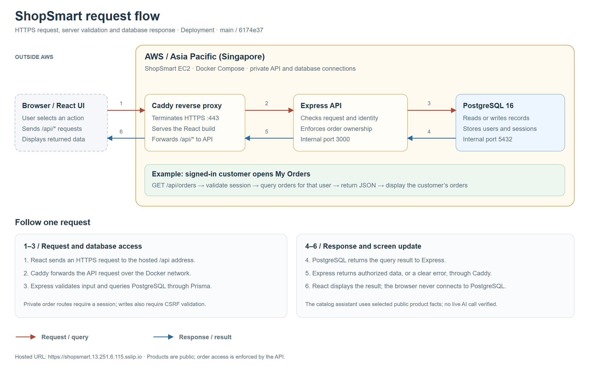
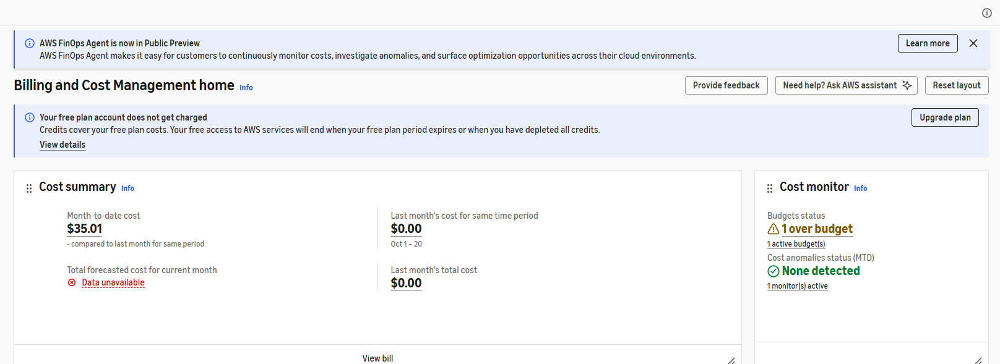
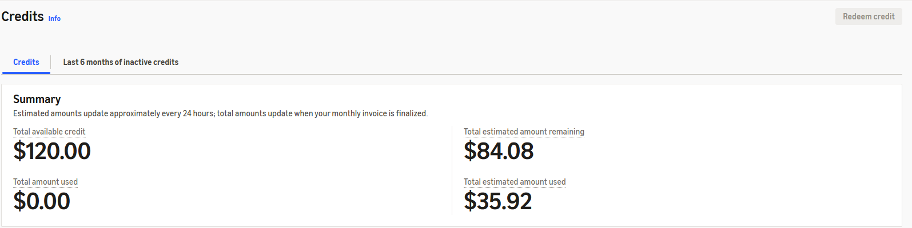
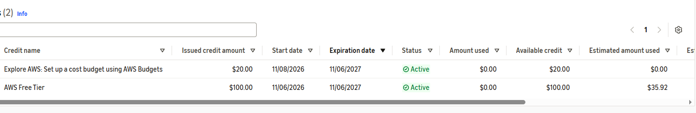

# ShopSmart AWS deployment report

Evidence date: November 20, 2026 (Asia/Manila).

## ShopSmart AWS Deployment

**Website:** [https://shopsmart.13.251.6.115.sslip.io](https://shopsmart.13.251.6.115.sslip.io)  
**Repository:** [https://github.com/kbfrrr/shopsmart](https://github.com/kbfrrr/shopsmart)  
**Deployed branch:** main  
**Deployed commit:** 6174e37

### Demo access

**Account 1:** customer.test1@example.com  
**Password:** [enter demo password]

**Account 2:** customer.test2@example.com  
**Password:** [enter demo password]

The deployment report is the main submission document. The test record and
release note are supporting Markdown files. Replace password placeholders only
in the private submission copy; keep real passwords out of the repository.

## Release details

| Item | Recorded value |
| --- | --- |
| Site | https://shopsmart.13.251.6.115.sslip.io |
| Repository | https://github.com/kbfrrr/shopsmart |
| Deployed branch and commit | `main`, `6174e37` |
| API image | `shopsmart-api:6174e37` |
| Web image | `shopsmart-web:6174e37` |
| Release type | Hosted classroom demonstration; simulated purchases |
| AWS Region / Availability Zone | Singapore, `ap-southeast-1` / `ap-southeast-1c` |
| Compute | Separate ShopSmart EC2, `t3.small`, Ubuntu 24.04 LTS |
| Storage | 20 GiB encrypted gp3 root volume; PostgreSQL named Docker volume |
| Administration | AWS Systems Manager Session Manager |
| Assistant | Catalog-based responses; no live provider call verified |

The final server screenshot shows API and PostgreSQL healthy, web running, and
the migration container exited with code 0. Both application images use `6174e37`.
The customer order list still shows order #6 after the update to main.

## Deployment diagram

[Open the scalable diagram](shopsmart-aws-architecture.svg).

### Request flow

[Open the scalable request-flow diagram](shopsmart-request-flow.svg).

HTTP port 80 supports certificate validation and HTTPS redirects. HTTPS staging
access was configured for the tester IP. API port 3000 and database port 5432 are
internal; Compose does not publish them to the host. Instructor access still needs
to be confirmed from the intended demonstration network.

## Architecture decision

We chose one separate EC2 instance for ShopSmart. Caddy serves the Vite build and
forwards API requests to Express. PostgreSQL runs in a private container on the
same host. This keeps the classroom deployment small and avoids introducing
Amplify, RDS, a load balancer, or a NAT gateway for this demonstration.

ShopSmart uses a separate instance from SAM10 so application updates and restarts
can be performed independently. The websites still share the AWS account and its
credits. A single ShopSmart host is a single point of failure. Operating-system
maintenance, database backups, HTTPS, and recovery remain our responsibility.

Sessions are stored in PostgreSQL. The API enforces order ownership; a delivery
email does not grant access to an order. Database migrations preserve existing
data. The destructive development seed was not used to upgrade the deployed data.

## AWS plan and shared costs

The AWS account runs two websites: ShopSmart and the SAM10 Residential Building
Assistant. The recorded costs and remaining credits are account-wide figures
covering both projects. The displayed cost is not attributable to ShopSmart alone.

| Evidence | Value shown |
| --- | --- |
| Account plan | Free plan |
| Billing-home month-to-date cost | US$35.01 |
| Budgets-page amount used | US$35.02 |
| Configured monthly budget | US$10.00 |
| Triggered budget thresholds | 85% and 100% of the US$10 budget |
| Monthly forecast | Data unavailable |
| Total issued credits | US$120.00 |
| Estimated credits used | US$35.92 |
| Estimated credits remaining | US$84.08 |
| Expiration shown for both active credits | November 6, 2027 |

The budget warning means recorded usage exceeded the configured US$10 target;
it does not mean credits were exhausted. The screenshots show different billing
and estimated-credit amounts; they are recorded as displayed rather than treated
as synchronized totals. Credit expiration is separate from the Free plan end date.
The Free plan end date has not yet been captured.

## Resource and removal record

| Resource | Purpose | Owner | Planned handling |
| --- | --- | --- | --- |
| ShopSmart EC2 and encrypted root volume | Web, API, database | Kobe Ferrer | Keep through November 30, 2026; confirm grading before removal |
| ShopSmart Elastic IP | Stable HTTPS hostname | Kobe Ferrer | Release after ShopSmart shutdown and grading confirmation |
| ShopSmart security group | Restrict inbound access | Kobe Ferrer | Review instructor access; remove when no longer attached or needed |
| ShopSmart EC2 IAM role | Session Manager administration | Kobe Ferrer | Review and remove if no longer used |
| PostgreSQL and Caddy Docker volumes | Database and certificate persistence | Kobe Ferrer | Export required data before deleting the host or volumes |

Resource creation dates should be transcribed from the AWS resource details;
they were not captured in the supplied evidence. SAM10 has its own removal decision.

A pre-authentication database dump was created on the ShopSmart host and shown as
nonempty (about 11 KB). An off-host copy and a restore test of that particular
backup remain unverified. Do not delete volumes or the instance as a test.

## Submission contents and remaining evidence

- [Hosted test record](AWS_TEST_RECORD.md)
- [Release note and two improvements](AWS_RELEASE_NOTE.md)
- This report, including the deployment diagram and architecture decision
- Live site and repository links listed above
- [Deployment, application, and cropped billing/credit screenshots](evidence/README.md)
- [Dependency review and unresolved findings](AWS_DEPENDENCY_REVIEW.md)

Selected screenshots are included in `docs/evidence`. Billing evidence excludes
the account header. Credit summary and expiration images exclude credit IDs.
The images retain results and monetary values. No passwords, tokens, payment
information, or private environment files are included.

### Account evidence

### Outstanding access and release limits

The Free plan end date and instructor-network reachability still require account
owner/instructor evidence. Fresh hosted health, readiness, guest API denial,
CSRF denial, assistant input validation, and nested-route refresh checks passed;
exact results are saved in the test record. Private log review and a restore test
of the server backup require server access and remain unverified. The dependency
review is complete and records ten unresolved findings; functional test results
do not resolve those findings.
